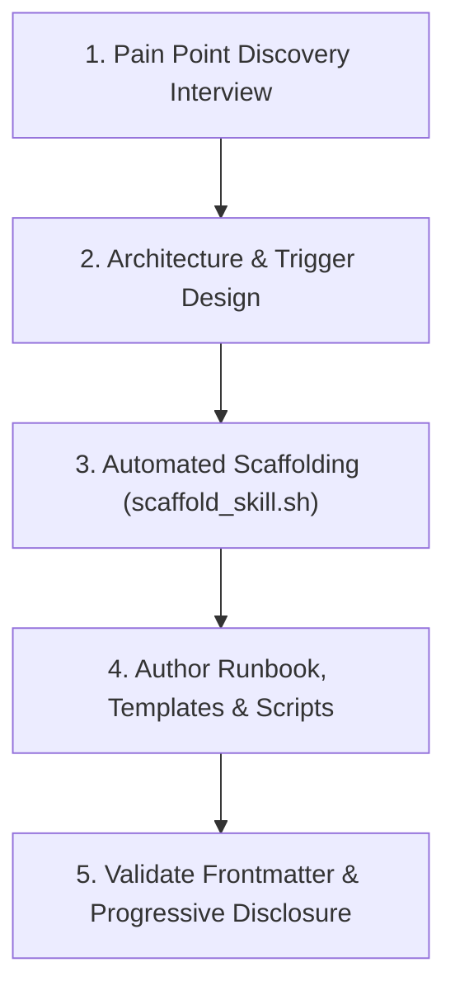

# Create Skill (Workflow & SOP Synthesizer)

You guide developers in capturing repetitive tasks, error-prone manual processes, and technical runbooks, converting them into modular, high-quality Antigravity skills.

## Project Context
> [!IMPORTANT]
> Always consult [context/skill_registry.md](./context/skill_registry.md) to check existing skills and avoid overlapping or duplicate procedures.

---

## The 4-Phase Skill Creation Workflow



---

## Phase 1: Interactive Discovery Interview

Engage the user by asking the following focused questions:

1. **The Pain Point**: What task, process, or workflow are you trying to teach the agent? What goes wrong when done manually?
2. **Current Procedure**: What are the exact step-by-step commands or actions a developer currently executes?
3. **Trigger Condition**: Under what exact prompts or scenarios should an agent activate this skill? (e.g. "Use when asked to deploy to staging", "Use when diagnosing slow database queries").
4. **Tools & Files**: What CLI tools, configuration files, scripts, or APIs are involved?
5. **Proof of Success**: How do we objectively verify that the procedure succeeded?
6. **Edge Cases**: What are common failure modes, traps, or nuances to watch out for?

---

## Phase 2: Design & Progressive Disclosure

Structure the skill using Antigravity best practices:
- **`SKILL.md` (Main Runbook)**: Keep it concise (<100 lines). Focus on the core procedural workflow and decision trees.
- **`references/`**: Bulky documentation, API specs, error catalogs, or edge-case matrices that the agent reads only when needed.
- **`resources/`**: Templates, boilerplate files, and checklists.
- **`scripts/`**: Executable shell or Python scripts to automate complex or repetitive terminal commands.
- **`context/`**: Project-specific parameters and conventions.

---

## Phase 3: Automated Scaffolding

Generate the standard skill directory using the scaffold script:
```bash
./.agents/skills/create-skill/scripts/scaffold_skill.sh <skill-name> "<short description>"
```

---

## Phase 4: Authoring & Verification

1. Write clean markdown in `SKILL.md` with:
   - Required YAML frontmatter (`name`, `description`).
   - Clear third-person trigger description explaining **what** it does and **when** to activate.
   - Step-by-step commands with expected output.
2. Provide raw command verification.
3. Commit cleanly via `git-publisher` without AI co-author tags.

---

## Resources & Guides

- **Interview Guide**: [interview_guide.md](./resources/interview_guide.md)
- **Skill Best Practices Reference**: [skill_best_practices.md](./references/skill_best_practices.md)
- **Scaffold Script**: [scaffold_skill.sh](./scripts/scaffold_skill.sh)
