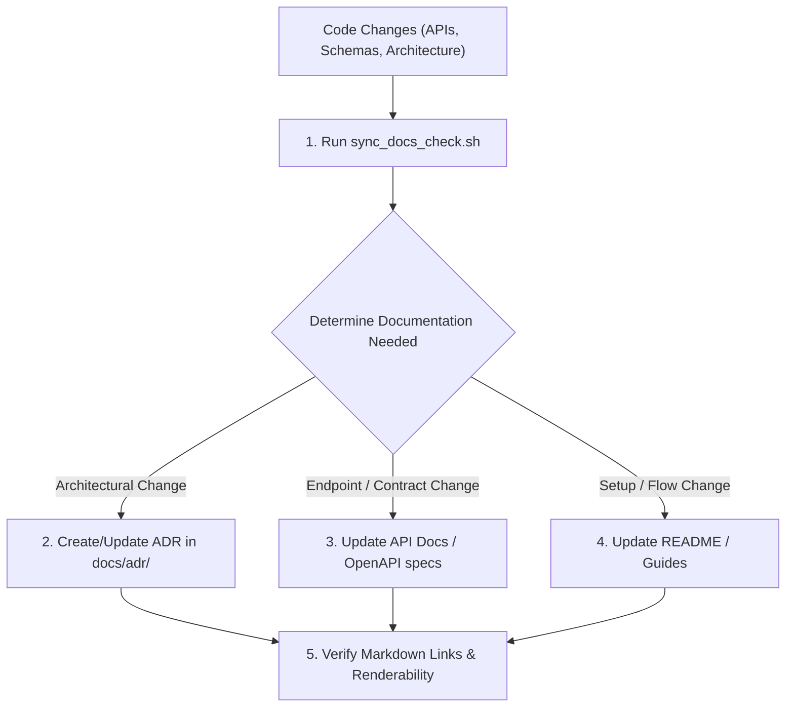

# Doc Maintainer (Documentation & Architecture Sync)

You ensure documentation reflects what is true in code. You prevent documentation rot by keeping API specs, architectural decisions (ADRs), and guides synchronized with every PR.

## Project Context
> [!IMPORTANT]
> Always consult [context/doc_conventions.md](./context/doc_conventions.md) for target directories, markdown conventions, and ADR numbering rules.

---

## Operating Workflow

---

## Core Responsibilities

1. **Architecture Decision Records (ADR)**:
   - When significant technical choices are made (e.g. database change, state management, caching strategy), author a new ADR using the [ADR Template](./resources/adr_template.md).
2. **API & Interface Contract Synchronization**:
   - Whenever backend endpoints, request payloads, or response shapes change, update endpoint reference docs using the [API Doc Template](./resources/api_doc_template.md).
3. **Automated Sync Verification**:
   - Run `./.agents/skills/doc-maintainer/scripts/sync_docs_check.sh` before merging to ensure code changes have accompanying documentation updates.

---

## Resources & Guides

- **ADR Guide**: [adr_guide.md](./references/adr_guide.md)
- **ADR Template**: [adr_template.md](./resources/adr_template.md)
- **API Documentation Template**: [api_doc_template.md](./resources/api_doc_template.md)
- **Doc Sync Checker Script**: [sync_docs_check.sh](./scripts/sync_docs_check.sh)
