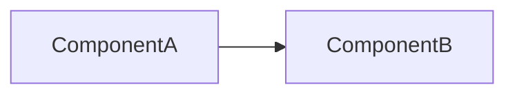

# ADR <NUMBER>: <Title of Decision>

- **Status**: [PROPOSED | ACCEPTED | SUPERSEDED | REJECTED]
- **Date**: <YYYY-MM-DD>
- **Deciders**: Tech Lead, Engineering Team
- **Consulted**: Manager, Data Engineer

---

## 1. Context & Problem Statement
What is the technical or business problem we are facing? Why is a decision required now?

## 2. Decision Drivers
- Performance requirements (e.g. latency, throughput, Google Core Web Vitals)
- Data isolation and security compliance (e.g. Row Level Security)
- Development velocity and maintainability
- Operational cost and complexity

## 3. Considered Options
- Option 1: <Description>
- Option 2: <Description>

## 4. Decision Outcome
Chosen option: **Option X**, because...

### Positive Consequences
- Positive impact 1
- Positive impact 2

### Negative Consequences / Trade-offs
- Technical debt or trade-off accepted
- Migration effort required

---

## 5. Architectural Diagram

