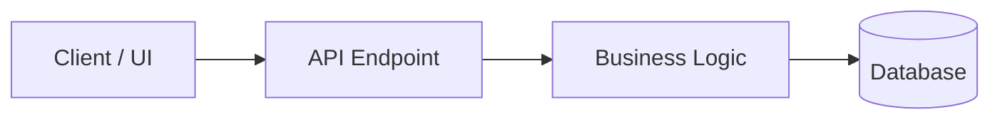

<!-- Pull Request Template -->
## Summary
<!-- Concise explanation of what was changed and why. Include issue reference. -->
Closes #<ISSUE_NUMBER>

## Architecture / Data Flow
<!-- Keep this mermaid diagram simple and high-level. -->

## Stack Status
<!-- If this is part of a stacked PR chain, list the sequence. Otherwise write 'N/A' -->
- Base PR: #<BASE_PR_NUMBER>
- Current: #<THIS_PR>
- Next PR: #<NEXT_PR_NUMBER>

## Key Changes
- Item 1: Description of change
- Item 2: Description of change

## Verification & Testing
<!-- Detail exact commands run and output status -->
- [ ] Unit tests pass: `npm test` or `python3 -m unittest`
- [ ] Verified no AI co-authorship tags exist in commit log
- [ ] Tested manually against issue acceptance criteria
