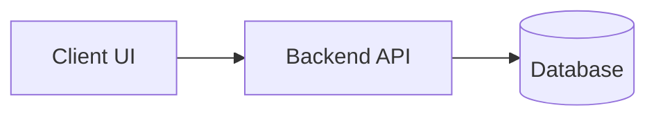

# Feature Implementation Plan: <Feature Name>

- **Type**: New Feature
- **Status**: Draft | Approved | In Progress | Complete
- **Issue Reference**: #<ISSUE_NUMBER>

---

## 1. Goal & Architecture Overview
- **User Objective**: What user need or capability is unlocked?
- **Architecture Diagram**:

---

## 2. Phase 1: Data Layer (Data Engineer)
- [ ] Schema changes & migrations.
- [ ] Primary key & foreign key indexing.
- [ ] Row Level Security (RLS) policies.
- **Verification Gate**: Migration syntax/schema check and query plan review (`EXPLAIN ANALYZE` proof). **Zero tests written by Data Engineer.**
- **Branch**: `feat/<name>-data` (targets `main`)

---

## 3. Phase 2: API & Domain Logic (Backend Developer)
- [ ] Interface types & DTO validation.
- [ ] Domain service logic & business rules.
- [ ] Controller endpoints & standardized error codes.
- **Verification Gate**: Static compilation/type check passing (`npx tsc --noEmit`). **Zero tests written or run by Backend Developer.**
- **Branch**: `feat/<name>-api` (stacked on `feat/<name>-data`)

---

## 4. Phase 3: User Interface & Experience (Frontend Developer)
- [ ] Responsive components & design system integration.
- [ ] State management, optimistic updates, and loading skeletons.
- [ ] Google Core Web Vitals audit (LCP < 2.5s, INP < 200ms, CLS < 0.1).
- **Verification Gate**: Static compilation/type check (`npx tsc --noEmit`), zero layout shift, bundle budget respected, and local preview URL documented. **Zero tests written or run by Frontend Developer.**
- **Branch**: `feat/<name>-ui` (stacked on `feat/<name>-api`)

---

## 5. Phase 4: Exclusive Test Creation & Verification (Tester)
- [ ] Author and execute unit, integration, component, and E2E tests.
- [ ] Execute live interactive UI scenario testing at local preview URL.
- [ ] Test edge cases and invalid inputs.
- [ ] Output recorded in `test-results/<issue>.md`.
