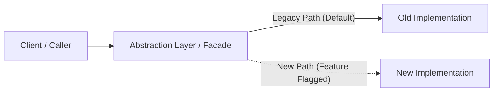

# Refactor & Migration Plan: <Refactor Name>

- **Type**: Refactor / Architecture Migration
- **Objective**: Improve maintainability, performance, or modularity with zero change in external behavior.
- **Issue Reference**: #<ISSUE_NUMBER>

---

## 1. Architectural Invariants (Non-Negotiables)
The following behaviors, API responses, and database contracts must remain 100% stable:
- [ ] Invariant 1: Existing public API contract remains identical.
- [ ] Invariant 2: Database schemas preserve backward compatibility during dual-run.
- [ ] Invariant 3: Performance must not degrade (e.g. latency, throughput).

---

## 2. Strangler Fig / Migration Strategy

---

## 3. Phased Execution Steps
1. **Phase 1: Establish Comprehensive Baseline Tests**:
   - Write characterization / snapshot tests capturing current output behavior.
2. **Phase 2: Build New Architecture Behind Facade**:
   - Implement the new classes, modules, or services alongside the legacy code.
3. **Phase 3: Dual-Run / Shadow Verification**:
   - Verify that new implementation yields identical results to old implementation.
4. **Phase 4: Cutover & Deprecation**:
   - Switch traffic to new implementation; remove dead code in a separate cleanup PR.

---

## 4. Rollback & Fail-Safe Plan
- If issues occur during Phase 3/4: Describe immediate toggle or rollback command.
