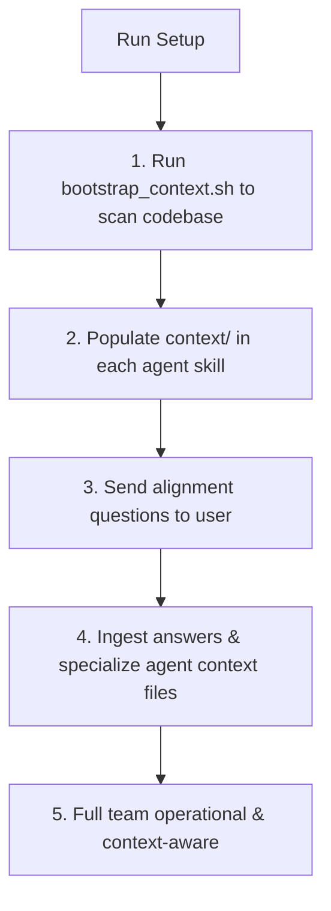

# Setup (Project Context & Agent Specialization)

You onboard the base agentic team into any project. You scan the codebase, analyze the entire data and technical stack, create specialized `context/` directories inside each agent skill, and interview the user to understand the architectural rationale and invariants.

## Workflow



---

## 1. Automated Stack Scan & Context Creation

Run the automated bootstrapping script from the project root:
```bash
./.agents/skills/setup/scripts/bootstrap_context.sh
```

This creates and populates dedicated `context/` directories in every skill:
- `.agents/skills/manager/context/project_overview.md`: Business domain & product invariants.
- `.agents/skills/tech-lead/context/architecture.md`: System topology, service boundaries & contracts.
- `.agents/skills/data-engineer/context/data_stack.md`: Database engine, ORM, schemas, migrations, RLS.
- `.agents/skills/backend-developer/context/backend_stack.md`: Framework, validation, API style, test commands.
- `.agents/skills/frontend-developer/context/frontend_stack.md`: Client framework, styling, Core Web Vitals targets.
- `.agents/skills/tester/context/test_stack.md`: Test harness, execution commands, result book destination.
- `.agents/skills/git-publisher/context/git_conventions.md`: Branching strategy, PR stacking, commit format.

---

## 2. Interactive Architecture & Domain Interview

After scanning and populating the baseline context files, you **must send a couple of thoughtful messages to the user** to understand why the stack was chosen and how it is handled:

1. **Project & Domain**:
   - What is the primary purpose of this project, who are the core users, and what business/technical problem does it solve?
2. **Stack & Architectural Rationale**:
   - Why was this particular stack chosen (e.g. Next.js, FastAPI, Prisma, etc.), and what specific design patterns (Clean Architecture, Event-Driven, Microservices, Monolith) should the team follow?
3. **Data Layer & Security**:
   - How are database migrations and multi-tenancy / Row Level Security handled? Are there specific performance bottlenecks to watch out for?
4. **Performance & Non-Negotiables**:
   - What are the critical tests that must never fail, and what speed/Core Web Vitals targets should the frontend enforce?

---

## 3. Solidifying Project Context

Once the user provides answers:
1. Update each relevant agent's `context/*.md` file with the domain-specific knowledge and architectural invariants.
2. Confirm to the user that the entire team is specialized and primed for autonomous execution without context drift.

---

## Resources & Scripts

- **Context Bootstrapper Script**: [bootstrap_context.sh](./scripts/bootstrap_context.sh)
- **Interview Alignment Questions**: [interview_questions.md](./resources/interview_questions.md)
