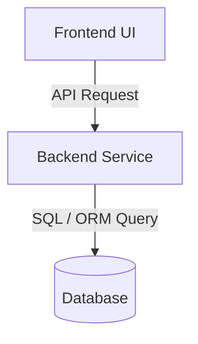

# Technical Architecture Specification: <Feature Name>

## 1. High-Level Architecture



## 2. Cross-Service Contract & Interface Definition

```typescript
// Shared Data Contract
export interface FeaturePayload {
  id: string;
  name: string;
  status: 'active' | 'archived';
  createdAt: string;
}
```

---

## 3. Sub-Ticket Breakdown & Delegation

### Ticket 1: Data Engineer (Base Layer)
- **Scope**: Schema definitions, indexes, RLS policies, migrations.
- **Deliverables**: Migration script + query plan review (`EXPLAIN ANALYZE`). Zero test files written.
- **Target Branch**: `feat/<feature>-data` (off `main`)

### Ticket 2: Backend Developer (API & Domain Logic)
- **Scope**: Endpoints, business logic, validation, error handling.
- **Deliverables**: Controllers, domain services, DTO validators, static type check (`npx tsc --noEmit`). Zero test files written.
- **Target Branch**: `feat/<feature>-backend` (stacked on `feat/<feature>-data`)

### Ticket 3: Frontend Developer (UI & User Experience)
- **Scope**: Client components, state management, accessibility, Google Core Web Vitals optimization.
- **Deliverables**: Responsive UI components, zero layout shifts (CLS < 0.1), static type check (`npx tsc --noEmit`), local preview URL for Tester. Zero test files written.
- **Target Branch**: `feat/<feature>-frontend` (stacked on `feat/<feature>-backend`)

### Ticket 4: Tester (Exclusive Test Creation & Verification)
- **Scope**: Unit, integration, component, and E2E test suites + interactive browser validation.
- **Deliverables**: Test files authored + `test-results/<issue>.md` with raw command output proofs.

---

## 4. Stacked PR Order & Verification
1. PR #1: Data Layer (`main` <- `feat/<feature>-data`)
2. PR #2: Backend Layer (`feat/<feature>-data` <- `feat/<feature>-backend`)
3. PR #3: Frontend Layer (`feat/<feature>-backend` <- `feat/<feature>-frontend`)
4. Pre-flight check by `code-reviewer`
5. Final Hand-off to `tester` for exclusive test authoring and end-to-end criteria verification.
