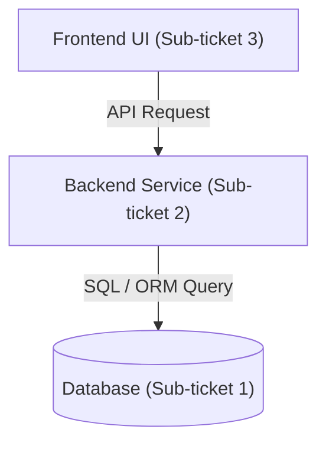

# Technical Architecture Specification: <Feature / Initiative Name>

## 1. High-Level Architecture & Multi-Ticket Mapping



## 2. Cross-Service Contract & Interface Definition

```typescript
// Shared Data Contract
export interface FeaturePayload {
  id: string;
  name: string;
  status: 'active' | 'archived';
  createdAt: string;
}
```

---

## 3. Sub-Ticket Breakdown & Autonomous Delegation Plan

### Sub-ticket 1: Data Engineer (PR 1 — Base Layer)
- **Origin**: Human Ticket 1 / Database persistence requirements.
- **Scope**: Schema definitions, indexes, RLS policies, migrations.
- **Deliverables**: Migration script + query plan review (`EXPLAIN ANALYZE`). Zero test files written.
- **Branch**: `feat/<feature>-1-data` (targets `main`).
- **Commit Bar**: At least one clean conventional commit via Committer.

### Sub-ticket 2: Backend Developer (PR 2 — API Layer)
- **Origin**: Human Ticket 1 & 2 / Business logic & endpoints.
- **Scope**: Endpoints, business logic, validation, error handling.
- **Deliverables**: Controllers, domain services, DTO validators, static type check (`npx tsc --noEmit`). Zero test files written.
- **Branch**: `feat/<feature>-2-api` (stacked on `feat/<feature>-1-data`).
- **Commit Bar**: At least one clean conventional commit via Committer.

### Sub-ticket 3: Frontend Developer (PR 3 — UI Layer)
- **Origin**: Human Ticket 1 & 2 / User experience & views.
- **Scope**: Client components, state management, accessibility, Google Core Web Vitals optimization.
- **Deliverables**: Responsive UI components, zero layout shifts (CLS < 0.1), static type check (`npx tsc --noEmit`), local preview URL for Tester. Zero test files written.
- **Branch**: `feat/<feature>-3-ui` (stacked on `feat/<feature>-2-api`).
- **Commit Bar**: At least one clean conventional commit via Committer.

---

## 4. Mandatory At Least 3 Stacked PRs Execution Order
1. **PR 1**: `feat/<feature>-1-data` -> `main` (Data Layer)
2. **PR 2**: `feat/<feature>-2-api` -> `feat/<feature>-1-data` (API Layer)
3. **PR 3**: `feat/<feature>-3-ui` -> `feat/<feature>-2-api` (UI Layer)
4. Pre-flight review by `code-reviewer` across all stacked PRs.
5. Final hand-off to `tester` for exclusive test authoring, test execution, and end-to-end criteria verification.
