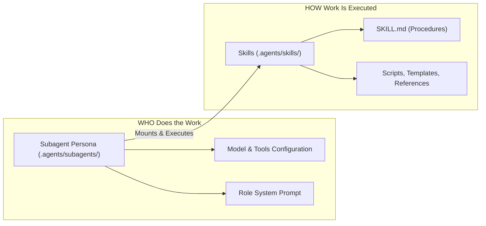

# Subagents Architecture & Declarations

This directory defines the **Actors / Personas** of the autonomous engineering team.

## Subagents vs. Skills

- **Skills (`.agents/skills/`)**:
  - Encapsulate procedures, checklists, scripts, and domain knowledge.
  - Examples: `git-publisher`, `schema-review`, `core-web-vitals`, `create-skill`.
  - Reusable across any agent or called on demand.

- **Subagents (`.agents/subagents/`)**:
  - Represent autonomous engineering roles.
  - Define tool access (`enableWriteTools`, `enableSubagentTools`, `enableMCPTools`), execution model (`pro`, `flash`, `inherit`), workspace isolation (`branch`, `share`, `inherit`), and which skills they mount.

---

## Registered Team Subagents

| Subagent | Role | Workspace | Mounted Skills | Permissions |
| :--- | :--- | :--- | :--- | :--- |
| **`manager`** | Product & UX Orchestrator | `inherit` | `manager` | Write, Subagents |
| **`tech-lead`** | System Architect & Coordinator | `inherit` | `tech-lead`, `git-publisher` | Write, Subagents |
| **`data-engineer`** | Database & Schema Specialist | `branch` | `data-engineer`, `git-publisher` | Write |
| **`backend-developer`** | API & Domain Engineer | `branch` | `backend-developer`, `git-publisher` | Write |
| **`frontend-developer`** | Client & Web Vitals Engineer | `branch` | `frontend-developer`, `git-publisher` | Write |
| **`tester`** | Independent Verification | `share` | `tester` | Write (Test code only) |
