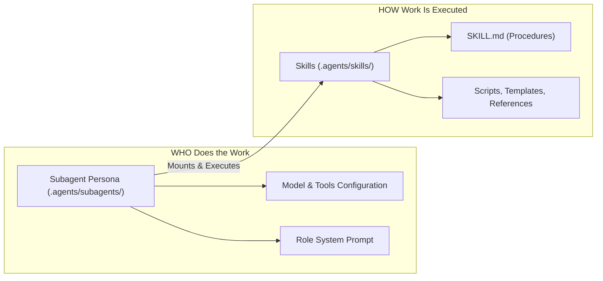
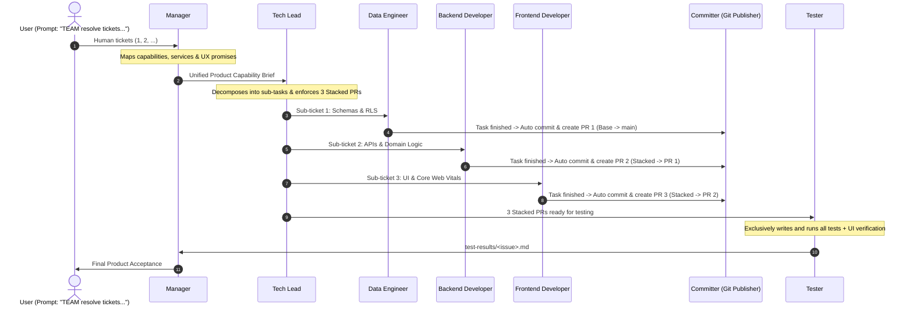

# Subagents Architecture & Declarations

This directory defines the **Actors / Personas** of the autonomous engineering team.

## Subagents vs. Skills

- **Skills (`.agents/skills/`)**:
  - Encapsulate procedures, checklists, scripts, and domain knowledge.
  - Examples: `git-publisher`, `schema-review`, `core-web-vitals`, `create-skill`.
  - Reusable across any agent or called on demand.

- **Subagents (`.agents/subagents/`)**:
  - Represent autonomous engineering roles.
  - Define tool access (`enableWriteTools`, `enableSubagentTools`, `enableMCPTools`), execution model (`pro`, `flash`, `inherit`), workspace isolation (`branch`, `share`, `inherit`), and which skills they mount.

---

## Registered Team Subagents

| Subagent | Role | Workspace | Mounted Skills | Permissions | Mandatory Responsibility |
| :--- | :--- | :--- | :--- | :--- | :--- |
| **`manager`** | Product & UX Orchestrator | `inherit` | `manager` | Write, Subagents | Multi-ticket intake, capability mapping, autonomous dispatch |
| **`tech-lead`** | System Architect & Coordinator | `inherit` | `tech-lead`, `planner`, `git-publisher` | Write, Subagents | Decomposes tickets into sub-tasks, plans **at least 3 stacked PRs**, autonomous dispatch |
| **`data-engineer`** | Database & Schema Specialist | `branch` | `data-engineer`, `git-publisher` | Write | Schema review, zero testing, hands off to committer (PR 1: Base) |
| **`backend-developer`** | API & Domain Engineer | `branch` | `backend-developer`, `git-publisher` | Write | Domain logic, zero testing, hands off to committer (PR 2: Stacked on PR 1) |
| **`frontend-developer`** | Client & Web Vitals Engineer | `branch` | `frontend-developer`, `git-publisher` | Write | Core Web Vitals UI, zero testing, hands off to committer (PR 3: Stacked on PR 2) |
| **`committer`** / **`git-publisher`** | Committer & PR Publisher | `inherit` | `git-publisher` | Write | **At least 1 commit per task**, builds stacked PRs, zero emojis/AI tags |
| **`tester`** | Independent Verification | `share` | `tester` | Write, MCP | **Exclusive owner of test creation & execution**, live UI verification |

---

## The `TEAM` Trigger Autonomous Execution Flow

When triggered with `TEAM` or `TEAM resolve`:

