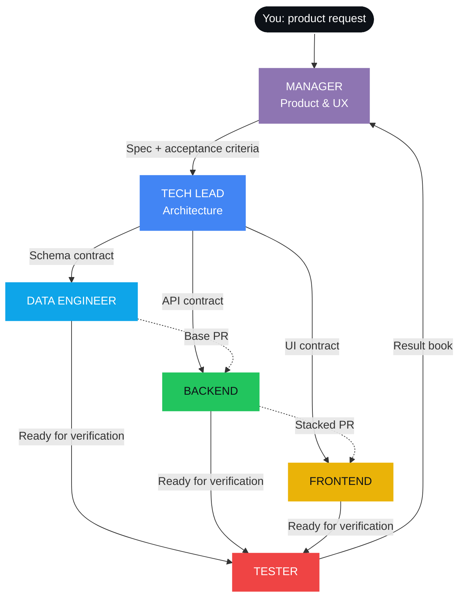
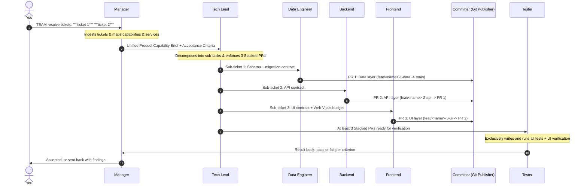

<p align="center">
  
</p>

<p align="center">
  
</p>

<p align="center">
  
  
  
</p>

<p align="center">
  
  
  
  
  
</p>

<br/>

<table align="center">
  <tr>
    <td align="center" width="200"><h1>8</h1><sub><b>SPECIALIZED AGENTS</b></sub></td>
    <td align="center" width="200"><h1>Less</h1><sub><b>LINES OF CODE FROM YOU</b></sub></td>
    <td align="center" width="200"><h1>min 3</h1><sub><b>STACKED PRs PER FEATURE</b></sub></td>
    <td align="center" width="200"><h1>1</h1><sub><b>RULE THAT CANNOT BREAK</b></sub></td>
  </tr>
</table>

<br/>

<p align="center">
  <a href="#-the-problem"><b>The Problem</b></a> &nbsp;&nbsp;|&nbsp;&nbsp;
  <a href="#-meet-the-team"><b>The Team</b></a> &nbsp;&nbsp;|&nbsp;&nbsp;
  <a href="#-engineering-skills"><b>Engineering Skills</b></a> &nbsp;&nbsp;|&nbsp;&nbsp;
  <a href="#-watch-a-feature-ship"><b>How It Ships</b></a> &nbsp;&nbsp;|&nbsp;&nbsp;
  <a href="#-install-in-60-seconds"><b>Install</b></a> &nbsp;&nbsp;|&nbsp;&nbsp;
  <a href="#-the-one-rule"><b>The Rule</b></a>
</p>


## <a id="-the-problem"></a>The problem

AI agents can write code all day. **That was never the hard part.**

The hard part is engineering: turning an idea into contracts, protecting the data layer, sequencing work, verifying independently and shipping pull requests a human can actually review.

Give one agent a big feature and you get one giant, unreviewable diff written by the same mind that approved it.

**agentic-engineering gives your agent a team instead.** Eight roles. Strict boundaries. Clean handoffs. The discipline of a senior engineering org, running entirely on agents, inside **any codebase**: full-stack apps, APIs, microservices or data platforms.

> Designed and battle-tested with **Gemini 4** inside Antigravity. But every skill is plain Markdown and scripts, so **Claude, GPT, Cursor or whatever agent you use** can run the whole team.


## <a id="-meet-the-team"></a>Meet the team

<table>
  <tr>
    <td width="25%" valign="top" align="center">
      <br/><br/>
      Product vision, customer journey and acceptance criteria.<br/><br/>
      <sub><b>NEVER READS OR WRITES CODE</b></sub>
    </td>
    <td width="25%" valign="top" align="center">
      <br/><br/>
      Architecture, cross-service contracts and task sequencing.<br/><br/>
      <sub><b>CONTRACTS BEFORE CODE</b></sub>
    </td>
    <td width="25%" valign="top" align="center">
      <br/><br/>
      Schemas, indexing, migrations and Row Level Security.<br/><br/>
      <sub><b>ALWAYS REVIEWS SCHEMAS FIRST</b></sub>
    </td>
    <td width="25%" valign="top" align="center">
      <br/><br/>
      Business logic, API endpoints, domain validation and error handling.<br/><br/>
      <sub><b>BUILDS ON THE DATA LAYER, NEVER AROUND IT</b></sub>
    </td>
  </tr>
  <tr>
    <td width="25%" valign="top" align="center">
      <br/><br/>
      Responsive interfaces held to Google Core Web Vitals.<br/><br/>
      <sub><b>LCP &lt; 2.5s &nbsp;·&nbsp; INP &lt; 200ms &nbsp;·&nbsp; CLS &lt; 0.1</b></sub>
    </td>
    <td width="25%" valign="top" align="center">
      <br/><br/>
      Exclusive test creation and independent verification in <code>test-results/&lt;issue&gt;.md</code>.<br/><br/>
      <sub><b>ONLY AGENT THAT WRITES TESTS · NEVER FIXES CODE</b></sub>
    </td>
    <td width="25%" valign="top" align="center">
      <br/><br/>
      Conventional commits, stacked PRs with <code>gh stack</code> and Mermaid diagrams.<br/><br/>
      <sub><b>NO AI CO-AUTHOR TAGS, EVER</b></sub>
    </td>
    <td width="25%" valign="top" align="center">
      <br/><br/>
      Scans your stack and gives every agent its own project context.<br/><br/>
      <sub><b>NO AGENT FLIES BLIND</b></sub>
    </td>
  </tr>
</table>

### The org chart




## <a id="-engineering-skills"></a>Engineering Skills & Toolkits

Beyond the core roles, the team mounts specialized procedural toolkits on demand:

<table>
  <tr>
    <td width="33%" valign="top">
      <h4>Planner</h4>
      Constructs phased implementation plans matching the task type:
      <ul>
        <li><b>Feature Plan</b>: Stacked architecture</li>
        <li><b>Bugfix RCA</b>: Reproduction & blast radius</li>
        <li><b>Refactor Plan</b>: Invariants & strangler fig</li>
        <li><b>Performance Plan</b>: Baselines & budgets</li>
      </ul>
      <sub>CLI: <code>./.agents/skills/planner/scripts/new_plan.sh</code></sub>
    </td>
    <td width="33%" valign="top">
      <h4>Code Reviewer</h4>
      Pre-flight automated gatekeeper reviewing diffs before merge:
      <ul>
        <li>OWASP Top 10 & SQL injection checks</li>
        <li>Leaked secrets & conflict markers</li>
        <li>N+1 query & index verification</li>
        <li>Core Web Vitals budget audit</li>
      </ul>
      <sub>Script: <code>./.agents/skills/code-reviewer/scripts/pre_review_audit.sh</code></sub>
    </td>
    <td width="33%" valign="top">
      <h4>Doc Maintainer</h4>
      Prevents documentation rot by keeping docs in lockstep with code:
      <ul>
        <li><b>ADR Management</b> (<code>docs/adr/</code>)</li>
        <li><b>API Specs</b> (OpenAPI / Markdown)</li>
        <li>Automated doc-sync checks on API diffs</li>
      </ul>
      <sub>Script: <code>./.agents/skills/doc-maintainer/scripts/sync_docs_check.sh</code></sub>
    </td>
  </tr>
  <tr>
    <td width="33%" valign="top">
      <h4>Create Skill</h4>
      Converts your repetitive developer pain points and manual runbooks into modular Antigravity skills via an interactive interview.
      <sub>CLI: <code>./.agents/skills/create-skill/scripts/scaffold_skill.sh</code></sub>
    </td>
    <td width="33%" valign="top">
      <h4>Git Publisher</h4>
      Enforces Conventional Commits, single PRs, stacked PRs (<code>gh stack</code>), and simple Mermaid diagrams. Never adds AI co-authors.
      <sub>Script: <code>./.agents/skills/git-publisher/scripts/verify_commit.sh</code></sub>
    </td>
    <td width="33%" valign="top">
      <h4>Setup & Context</h4>
      Scans any project stack and populates isolated <code>context/</code> folders in each agent so nobody loses the plot.
      <sub>Script: <code>./.agents/skills/setup/scripts/bootstrap_context.sh</code></sub>
    </td>
  </tr>
  <tr>
    <td width="50%" valign="top">
      <h4>Markdown RAG Service</h4>
      Token-efficient context extraction for large files. Uses regex to scan headings (<code>#</code> to <code>######</code>), Mermaid diagrams, code blocks, alerts, and tables—reading only in-between lines.
      <sub>CLI: <code>python3 .agents/tools/rag_service.py extract-diagrams</code> | <code>get-topics</code></sub>
    </td>
    <td width="50%" colspan="2" valign="top">
      <h4>Dependency Graph Service</h4>
      Tracks entity relationships with predefined taxonomies (<code>dangerously_*</code>, <code>tests</code>, architecture), blast-radius impact analysis (<code>check-impact</code>), and live Mermaid sync.
      <sub>CLI: <code>python3 .agents/tools/graph_service.py check-impact &lt;node&gt;</code></sub>
    </td>
  </tr>
</table>


## <a id="-watch-a-feature-ship"></a>Watch a feature ship

You trigger with `TEAM`. The team does the rest.



<table>
  <tr>
    <td align="center"></td>
    <td align="center"><b>→</b></td>
    <td align="center"></td>
    <td align="center"><b>→</b></td>
    <td align="center"></td>
  </tr>
</table>

Small, focused diffs, stacked in the order a senior reviewer would want them.


## <a id="-install-in-60-seconds"></a>Install in 60 seconds

**1. Bring the team into your repo**

```bash
git clone https://github.com/pato-byepaper/agentic-engineering.git
cp -r agentic-engineering/.agents ./your-project/
```

**2. Onboard them**

```bash
cd your-project
./.agents/skills/setup/scripts/bootstrap_context.sh
```

**3. Talk to the Manager**

Describe what you want in product terms. Not code. Not files. Just the outcome.

### What setup learns about your project

| It detects | Like |
|:---|:---|
| **Languages & frameworks** | Node, TypeScript, Python, Go, Rust, React, Next.js, Vue, FastAPI, Django |
| **Data layer & ORMs** | Postgres, MySQL, SQLite, MongoDB, Prisma, Drizzle, SQLAlchemy |
| **Testing suites** | Vitest, Jest, Playwright, Pytest, Go test |
| **Git conventions** | Main branch, remotes, stacked PR settings |

Every agent gets its own `context/` folder, so **nobody loses the plot**. Then setup runs an **alignment interview** with you to capture what code can't explain: your business domain, your users and why your architecture looks the way it does.


## The guardrails

The power of this team isn't what each agent can do. **It's what each agent is forbidden to do.**

| | Rule | Why |
|:---:|:---|:---|
| **01** | The Manager never touches code | Product decisions stay product decisions |
| **02** | The Tech Lead defines contracts first | Nobody builds against an interface that doesn't exist |
| **03** | The Data Engineer goes first | Schemas are reviewed before a single endpoint exists |
| **04** | At least 3 stacked PRs | Full-stack changes are stacked: Data -> Backend -> Frontend |
| **05** | At least 1 commit per task | Committer commits proactively; never leave uncommitted work |
| **06** | Developers never write or run tests | Only the Tester creates and executes tests so no coder self-certifies |
| **07** | The Tester never fixes | Findings go back to the owner, not around them |
| **08** | No emojis in commits or PRs | Clean, professional plain text without decoration |
| **09** | Dual simple diagrams in PRs | Every PR illustrates logic flow and test execution |
| **10** | No AI co-author tags | Git history is written for humans |


## <a id="-the-one-rule"></a>The one rule

<p align="center">
  
</p>

<p align="center">
  <b>The one who builds is never the one who approves.</b><br/>
  Every change is verified independently by the Tester. No exceptions.
</p>


## Repository structure

```text
.agents/
├── subagents/                     # WHO does the work (Agent Personas & Manifests)
│   ├── manager.json
│   ├── tech-lead.json
│   ├── data-engineer.json
│   ├── backend-developer.json
│   ├── frontend-developer.json
│   ├── committer.json
│   └── tester.json
│
├── tools/                         # Custom CLI & MCP services for AGY Gemini models
│   ├── rag_service.py             # Token-efficient regex RAG (get-topics, extract, save)
│   ├── graph_service.py           # Dependency graph & live Mermaid sync
│   └── mcp_server.py              # Zero-dependency Model Context Protocol stdio server
│
└── skills/                        # HOW work is executed (Procedures & Toolkits)
    ├── manager/
    ├── tech-lead/
    ├── data-engineer/
    ├── backend-developer/
    ├── frontend-developer/
    ├── tester/
    ├── git-publisher/
    ├── setup/
    ├── rag-service/               # Regex-based markdown RAG procedures
    ├── graph-service/             # Dependency relationship graph procedures
    ├── planner/                   # Structured Feature/Bugfix/Refactor/Perf plans
    ├── code-reviewer/             # Pre-flight OWASP, N+1, & Web Vitals audit
    ├── doc-maintainer/            # Automatic ADR & API spec synchronization
    └── create-skill/              # Converts developer pain points into skills
```

## Contributing

Designed a new role? Found a rule that makes the team better? Open a PR. Just remember: **someone else will review it.**

## License

[MIT](LICENSE)

<p align="center">
  
</p>

<p align="center">
  <sub>Built by <a href="https://github.com/pato-byepaper"><b>Pato</b></a> at <a href="https://github.com/ByePaper"><b>ByePaper</b></a></sub>
</p>
