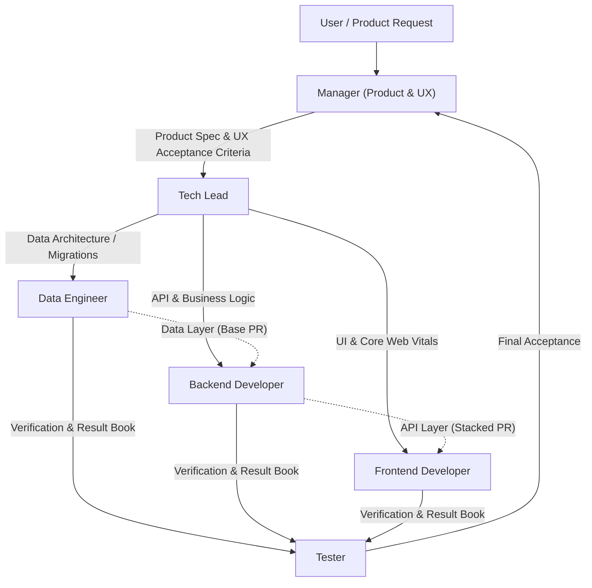

# Antigravity Autonomous Engineering Team

A professional, modular AI software engineering team built with Antigravity (`agy`) skills. Designed to be deployed into **any codebase**—from full-stack web applications and APIs to microservices and data platforms.

## The Engineering Team



### Roles & Responsibilities

1. **Manager** (`.agents/skills/manager/`): Product vision, customer journey, and acceptance criteria. **Never reads or writes code**.
2. **Tech Lead** (`.agents/skills/tech-lead/`): Architecture decomposition, cross-service interface contracts, and task sequencing for coders.
3. **Data Engineer** (`.agents/skills/data-engineer/`): Schemas, indexing, migrations, and Row Level Security (RLS). **Always reviews schemas first**.
4. **Backend Developer** (`.agents/skills/backend-developer/`): Business logic, API endpoints, domain validation, and server test suites.
5. **Frontend Developer** (`.agents/skills/frontend-developer/`): Responsive interfaces adhering strictly to **Google Core Web Vitals** (LCP < 2.5s, INP < 200ms, CLS < 0.1).
6. **Tester** (`.agents/skills/tester/`): Independent verification against requirements in `test-results/<issue>.md`. Never fixes code.
7. **Git Publisher** (`.agents/skills/git-publisher/`): Conventional commits, PR generation, stacked PRs (`gh stack`), and simple Mermaid diagrams. **Never includes AI co-author tags**.
8. **Setup** (`.agents/skills/setup/`): Onboards the team into any codebase. Automatically scans the project stack and populates dedicated `context/` directories inside each agent.

---

## Onboarding Any Codebase (`setup`)

When installing these skills into a repository, run the `setup` workflow:

```bash
./.agents/skills/setup/scripts/bootstrap_context.sh
```

This automatically scans:
- **Languages & Frameworks**: Node, TypeScript, Python, Go, Rust, React, Next.js, Vue, FastAPI, Django, etc.
- **Data Layer & ORMs**: Postgres, MySQL, SQLite, MongoDB, Prisma, Drizzle, SQLAlchemy, etc.
- **Testing Suites**: Vitest, Jest, Playwright, Pytest, Go test, etc.
- **Git & Branching Settings**: Main branch, remotes, stacked PR conventions.

It then populates dedicated `context/` directories inside each agent so **no agent loses project context**. Finally, it prompts an alignment interview to understand the business domain and architectural rationale.

---

## Core Principle

**Nadie corrige su propia tarea (Nobody fixes their own work).** Verification is always conducted independently by the Tester.

## License

MIT
