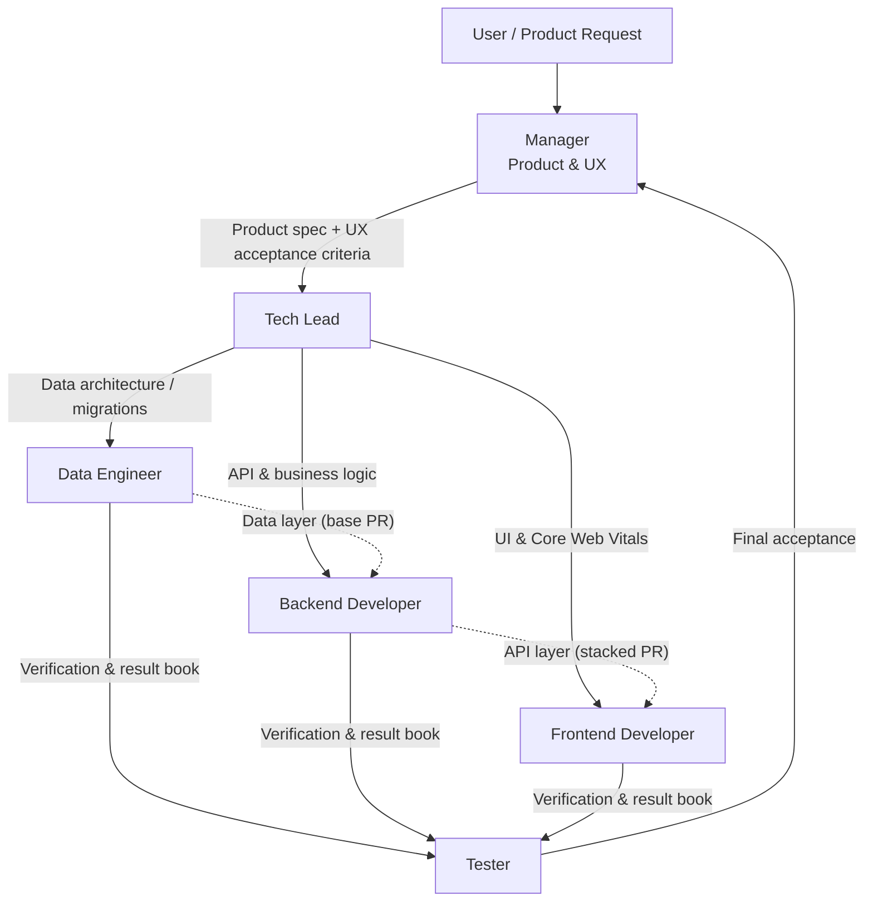
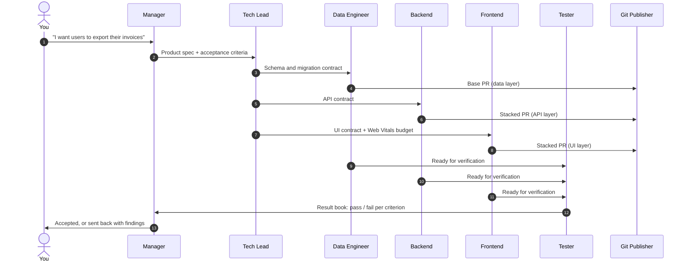

<div align="center">

# agentic-engineering

### Low code. High engineering.

**A complete AI software engineering team, packaged as agent skills.**
You stop writing code and start designing the mind behind it.

<br/>


<br/>

[The Team](#the-team) &nbsp;·&nbsp; [How It Works](#how-a-feature-ships) &nbsp;·&nbsp; [Quick Start](#quick-start) &nbsp;·&nbsp; [Guardrails](#the-guardrails) &nbsp;·&nbsp; [Philosophy](#core-principle)

</div>

---

## Why this exists

AI agents can already write code. What they can't do on their own is **engineer**: split a product into contracts, sequence the work, protect the data layer, verify independently and ship clean pull requests.

`agentic-engineering` gives your agent a real team structure. Eight specialized roles, each with strict boundaries, its own context and a clear handoff to the next. The same discipline a senior engineering team follows, running entirely on agents.

Deploy it into **any codebase**: full-stack web apps, APIs, microservices or data platforms.

> Built and battle-tested with **Antigravity (`agy`) and Gemini 4**. The skills are plain Markdown and scripts, so any agent that can follow file-based instructions can run the team.

---

## The team



| Role                   | Owns                                                                     | Hard rule                                                 |
| ---------------------- | ------------------------------------------------------------------------ | --------------------------------------------------------- |
| **Manager**            | Product vision, customer journey, acceptance criteria                    | Never reads or writes code                                |
| **Tech Lead**          | Architecture decomposition, cross-service contracts, task sequencing     | Defines the interfaces before anyone builds               |
| **Data Engineer**      | Schemas, indexing, migrations, Row Level Security                        | Always reviews schemas first                              |
| **Backend Developer**  | Business logic, API endpoints, domain validation, server tests           | Builds on top of the data layer, never around it          |
| **Frontend Developer** | Responsive interfaces                                                    | Meets Core Web Vitals: LCP < 2.5s, INP < 200ms, CLS < 0.1 |
| **Tester**             | Independent verification in `test-results/<issue>.md`                    | Never fixes code                                          |
| **Git Publisher**      | Conventional commits, PRs, stacked PRs with `gh stack`, Mermaid diagrams | Never adds AI co-author tags                              |
| **Setup**              | Onboarding the team into any codebase                                    | Every agent gets its own project context                  |

Every role lives in its own folder under `.agents/skills/<role>/`.

---

## How a feature ships



Each layer lands as its own pull request, stacked on the one below it. Reviewers see small, focused diffs in the right order: data, then API, then UI.

---

## Quick start

**1. Add the team to your repository**

Copy the `.agents/` folder from this repo into the root of your project:

```bash
git clone https://github.com/pato-byepaper/agentic-engineering.git
cp -r agentic-engineering/.agents ./your-project/
```

**2. Onboard the team**

From your project root, run the setup workflow:

```bash
./.agents/skills/setup/scripts/bootstrap_context.sh
```

**3. Talk to the Manager**

Describe what you want in product terms. The team takes it from there.

---

## What setup does

The `setup` skill scans your project and writes a dedicated `context/` folder inside every agent, so **no agent ever loses project context**.

| It detects               | Examples                                                                 |
| ------------------------ | ------------------------------------------------------------------------ |
| Languages and frameworks | Node, TypeScript, Python, Go, Rust, React, Next.js, Vue, FastAPI, Django |
| Data layer and ORMs      | Postgres, MySQL, SQLite, MongoDB, Prisma, Drizzle, SQLAlchemy            |
| Testing suites           | Vitest, Jest, Playwright, Pytest, Go test                                |
| Git conventions          | Main branch, remotes, stacked PR settings                                |

Then it runs an **alignment interview** with you to capture what code can't tell it: the business domain, the users and the reasoning behind your architecture.

---

## The guardrails

The power of this team is in what each agent is **not allowed** to do.

- **The Manager never touches code.** Product decisions stay product decisions.
- **The Tech Lead defines contracts first.** Nobody builds against an interface that doesn't exist yet.
- **The Data Engineer goes first.** Schemas are reviewed before a single endpoint is written.
- **The Tester never fixes.** Findings go back to the role that owns the work.
- **The Git Publisher writes history for humans.** Conventional commits, stacked PRs, simple diagrams and no AI co-author tags.

---

## Repository structure

```text
.agents/
  skills/
    manager/
    tech-lead/
    data-engineer/
    backend-developer/
    frontend-developer/
    tester/
    git-publisher/
    setup/
      scripts/
        bootstrap_context.sh
```

---

## Core principle

<div align="center">

### Nadie corrige su propia tarea.

#### Nobody fixes their own work.

Verification is always done independently by the Tester.
The one who builds is never the one who approves.

</div>

---

## License

[MIT](LICENSE). Use it, fork it, and if you design a new role, send a PR.

<div align="center">
<br/>
<sub>Built by <a href="https://github.com/pato-byepaper">Pato</a> at <a href="https://github.com/ByePaper">ByePaper</a>.</sub>
</div>
